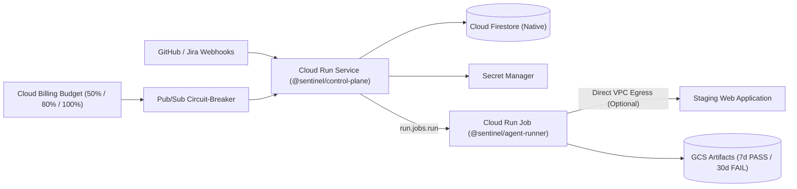

# Sentinel Serverless QA Runtime — Google Cloud Terraform Module (`leansoler/sentinel/google`)

[](https://registry.terraform.io/modules/leansoler/sentinel/google)
[](https://www.terraform.io)
[](https://registry.terraform.io/providers/hashicorp/google/latest)

Official Terraform module for deploying **Sentinel** (`@sentinel/*`) — the cloud-native, 100% automated post-merge black-box QA platform — directly inside a **Customer-Hosted Google Cloud Platform (GCP) Bring-Your-Own-Cloud (BYOC)** perimeter.

---

## Architecture Provisioned



This module provisions:
1. **`@sentinel/control-plane` (Cloud Run v2 Service)**: Scale-to-zero (`min_instance_count = 0`) Fastify API, webhook gateway, quota & circuit-breaker controller, and embedded `/dashboard`.
2. **`@sentinel/agent-runner` (Cloud Run v2 Job)**: Ephemeral single-run headless browser worker (Stagehand + Playwright) with a 5-minute hard timeout (`300s`) and `max_retries = 0`.
3. **Cloud Firestore (Native Mode)**: Multi-tenant metadata store (`tenants/{tenantId}/projects/{projectId}/runs/{runId}`).
4. **Google Cloud Storage (`sentinel-artifacts-*`)**: Evidence bucket with Uniform Bucket-Level Access (UBLA) and automated 7-day `PASS` / 30-day `FAIL` retention lifecycle rules.
5. **Secret Manager & Least-Privilege IAM**: Dedicated service accounts (`sentinel-control-plane-sa`, `sentinel-agent-runner-sa`) with strictly scoped roles.
6. **Cloud Billing Budget Guardrails**: Automated spend alerts at 50%, 80% (soft-cap downgrade to `SMOKE_ONLY`), and 100% (hard-cap circuit breaker) via Cloud Pub/Sub.

---

## Pre-Flight Prerequisite: Artifact Registry Reader Access

Sentinel distributes official, cryptographically signed container images from its central Google Artifact Registry (`us-central1-docker.pkg.dev/sentinel-release/sentinel/...`).

Before running `terraform apply`, ensure your customer GCP project's **Cloud Run Service Agent** and **Compute Engine Default Service Account** have been granted `roles/artifactregistry.reader` by Sentinel:

```bash
# 1. Enable Cloud Run API so Google provisions your Cloud Run Service Agent:
gcloud services enable run.googleapis.com --project="<YOUR_GCP_PROJECT_ID>"

# 2. Retrieve your numeric GCP Project Number:
PROJECT_NUMBER=$(gcloud projects describe "<YOUR_GCP_PROJECT_ID>" --format="value(projectNumber)")
echo "Project Number: ${PROJECT_NUMBER}"

# 3. Provide your Project Number to Sentinel support (or run from vendor admin workspace):
#    ./infra/scripts/manage-customer-access.sh grant ${PROJECT_NUMBER}
#    ./infra/scripts/manage-customer-access.sh grant serviceAccount:service-${PROJECT_NUMBER}@serverless-robot-prod.iam.gserviceaccount.com
```

---

## Quickstart Usage

### 1. Minimal Turnkey BYOC Deployment (`examples/basic-byoc`)

Create a `main.tf` in your infrastructure repository. Only `project_id` is required—container images automatically resolve from `sentinel_version`:

```hcl
module "sentinel" {
  source  = "leansoler/sentinel/google"
  version = "~> 0.2"

  project_id                = "acme-sentinel-prod"
  region                    = "us-central1"
  sentinel_version          = "0.2.0" # x-release-please-version
  monthly_budget_amount_usd = 100.0
  default_webhook_secret    = var.sentinel_webhook_secret
}

output "control_plane_url" {
  value = module.sentinel.control_plane_url
}
```

Then initialize and apply:

```bash
terraform init
terraform apply
```

### 2. Private VPC Staging with Direct VPC Egress (`examples/vpc-egress`)

To test internal staging web applications hosted inside a private VPC without exposing them to the public internet:

```hcl
module "sentinel" {
  source  = "leansoler/sentinel/google"
  version = "~> 0.1"

  project_id                = "acme-corp-infra"
  region                    = "us-central1"
  sentinel_version          = "0.2.0" # x-release-please-version
  billing_account_id        = "012345-6789AB-CDEF01"
  monthly_budget_amount_usd = 250.0
  default_webhook_secret    = var.sentinel_webhook_secret

  # Connect Cloud Run & Agent Runner directly to your private VPC subnet:
  vpc_network_name    = "projects/acme-corp-infra/global/networks/staging-vpc"
  vpc_subnetwork_name = "projects/acme-corp-infra/regions/us-central1/subnetworks/staging-private-subnet"
}
```

---

## Requirements

| Name | Version |
| :--- | :--- |
| `terraform` | `>= 1.5.0` |
| `google` (`hashicorp/google`) | `>= 6.0` |
| `random` (`hashicorp/random`) | `~> 3.6` |

---

## Inputs

| Name | Description | Type | Default | Required |
| :--- | :--- | :--- | :--- | :---: |
| `project_id` | The GCP Project ID where Sentinel runtime resources are provisioned. | `string` | n/a | **yes** |
| `region` | The GCP Region for Cloud Run, Cloud Run Jobs, Firestore, and GCS. | `string` | `"us-central1"` | no |
| `sentinel_version` | Sentinel release version string (e.g. `"0.1.0"`). Automatically sets default image tags. | `string` | `"0.1.0"` | no |
| `monthly_budget_amount_usd` | Monthly maximum spend cap in USD for Sentinel GCP resources. | `number` | `100.0` | no |
| `billing_account_id` | Optional GCP Billing Account ID for Cloud Billing Budget guardrails. | `string` | `null` | no |
| `default_tenant_id` | Default workspace/tenant identifier for single-tenant or default-tenant setups. | `string` | `"default"` | no |
| `default_webhook_secret` | Default secret for validating GitHub/Jira HMAC-SHA256 signatures. | `string` | `"sentinel-webhook-default-secret"` | no |
| `control_plane_image` | Optional override for `@sentinel/control-plane` image URI. Defaults to official Artifact Registry image for `sentinel_version`. | `string` | `null` | no |
| `agent_runner_image` | Optional override for `@sentinel/agent-runner` image URI. Defaults to official Artifact Registry image for `sentinel_version`. | `string` | `null` | no |
| `vpc_network_name` | Optional VPC Network name for Direct VPC Egress (internal staging testing). | `string` | `null` | no |
| `vpc_subnetwork_name` | Optional VPC Subnetwork name for Direct VPC Egress. | `string` | `null` | no |
| `enable_dashboard` | Whether to mount the in-band Sentinel Web Dashboard (`/dashboard`) on the Control Plane service. | `bool` | `true` | no |

---

## Outputs

| Name | Description |
| :--- | :--- |
| `control_plane_url` | Public HTTPS URI of the Sentinel Control Plane Cloud Run service. |
| `agent_runner_job_name` | Name of the provisioned Cloud Run Job for browser agent workers. |
| `artifacts_bucket_name` | Name of the provisioned GCS bucket with 7d/30d retention lifecycle policies. |
| `budget_alerts_pubsub_topic` | Pub/Sub topic ID receiving Cloud Billing Budget alerts at 50%, 80%, and 100%. |
| `control_plane_service_account_email` | Email of the Sentinel Control Plane service account (`sentinel-control-plane-sa@...`). |
| `agent_runner_service_account_email` | Email of the Sentinel Agent Runner service account (`sentinel-agent-runner-sa@...`). |
| `sentinel_version` | Sentinel component release version deployed in this environment. |
| `control_plane_image` | Resolved container image URI deployed for the Sentinel Control Plane service. |
| `agent_runner_image` | Resolved container image URI deployed for the Sentinel Agent Runner job. |

---

## Changelog & Releases

See [`CHANGELOG.md`](./CHANGELOG.md) for the automated release history of this Terraform module, or browse the [GitHub Releases](https://github.com/leansoler/terraform-google-sentinel/releases).
